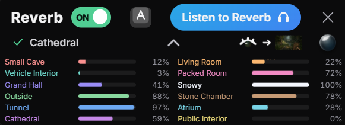
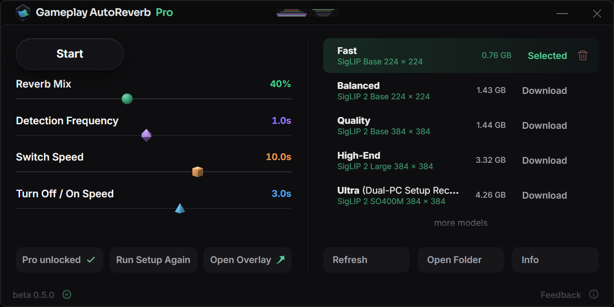
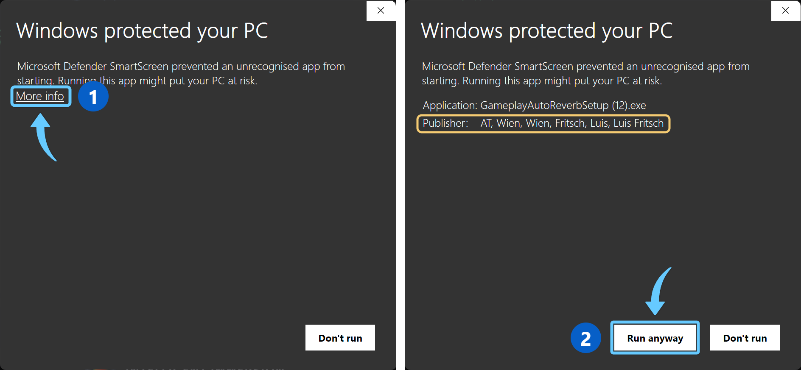
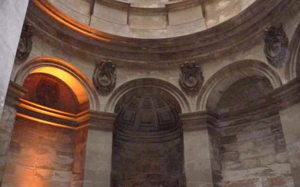
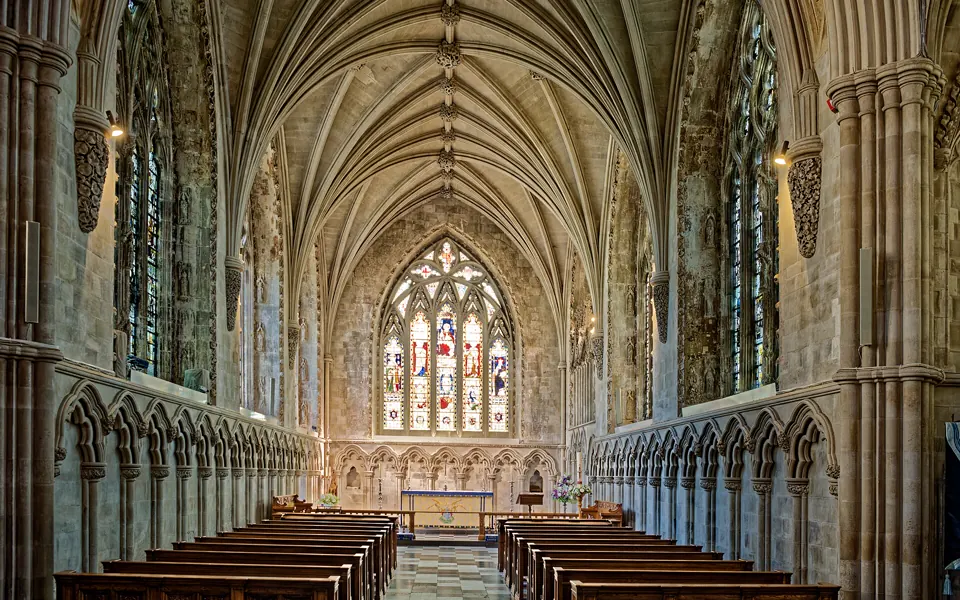
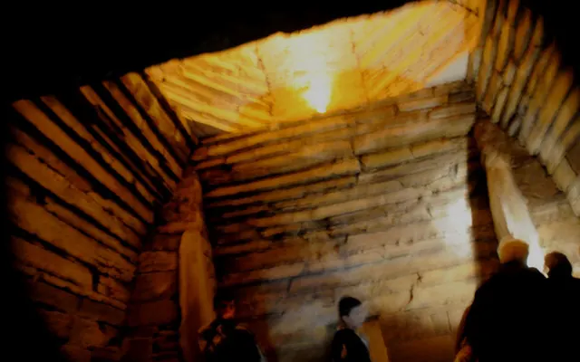
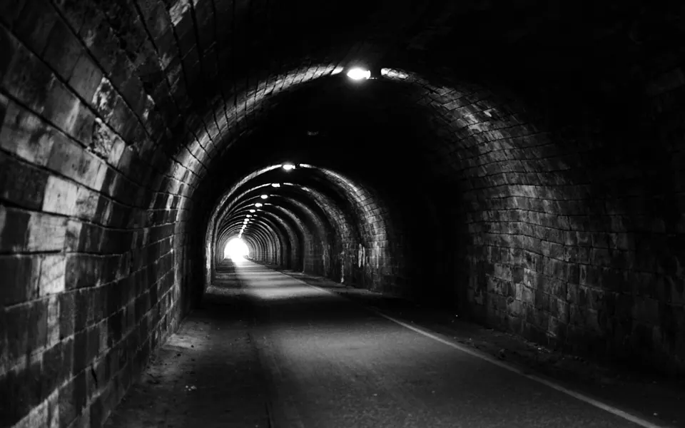
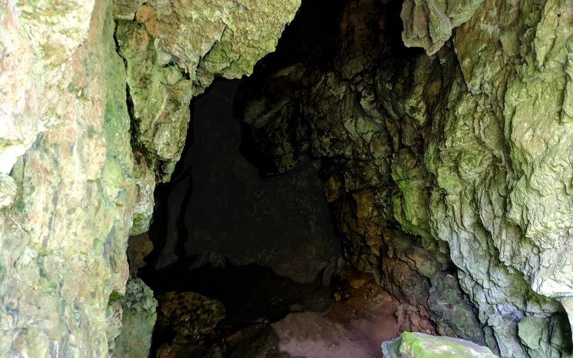
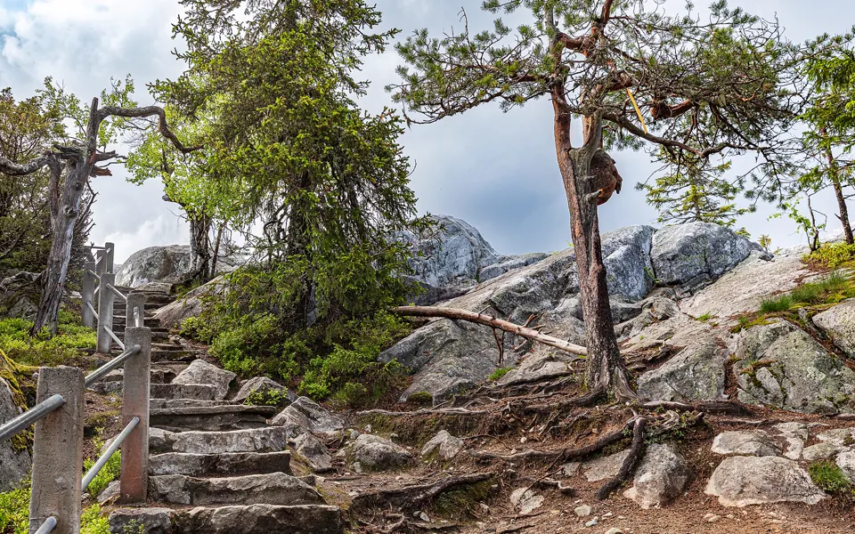

 

## How to install

> [!IMPORTANT]
> **Please read**
>
> Windows SmartScreen may show a pop-up. Gameplay AutoReverb is digitally signed in my name and safe to install.
>
> Thank you for giving Gameplay AutoReverb a try!
>
> \- Luis
>
> Click **More info** → **Run anyway**.
>
> 
>
> 

## Voice reverb that adapts to your game

Gameplay AutoReverb detects the in-game environment and automatically matches your microphone reverb to the scene.

- **Automatic scene matching** — Adapts reverb as you move between caves, cathedrals, forests, dungeons, and spaceship interiors.
- **Built for OBS** — Processes your microphone through the included VST3 effect, ready for streams and recordings.
- **Control when you need it** — Toggle reverb, preview the effect, set a hotkey, and adjust the mix from one panel.
- **100% local** — Scene detection and audio control run on your PC. No gameplay or microphone audio is uploaded.

## Reverb recorded in real places

The reverb comes from impulse responses measured on location — real caves, cathedrals, tunnels and forests.

  
  
  

  
  
  

<b>Hamilton Mausoleum</b> · <b>St Albans Cathedral</b> · <b>Maes Howe</b> · <b>Railway Tunnel</b> · <b>Creswell Crags</b> · <b>Koli National Park</b> and more ...

Photos: Wikimedia Commons, cropped — <a href="https://commons.wikimedia.org/wiki/File:Hamilton_Mausoleum_-_geograph.org.uk_-_3130601.jpg">Louise Harris</a> (CC BY-SA 2.0), <a href="https://commons.wikimedia.org/wiki/File:Abbey_Church_of_St_Alban,_The_Lady_Chapel_St_Albans_1103163_20230926_0120.jpg">Tilman2007</a> (CC BY-SA 4.0), <a href="https://commons.wikimedia.org/wiki/File:Maeshowe,_Neolithic_Orkney._(The_Inside)_-_geograph.org.uk_-_889167.jpg">Malcolm Morris</a> (CC BY-SA 2.0), <a href="https://commons.wikimedia.org/wiki/File:Innocent_Railway_tunnel_(20477254869).jpg">Ben Heathwood</a> (CC BY 2.0), <a href="https://commons.wikimedia.org/wiki/File:Robin_Hood_Cave,_Creswell_Crags_(12).jpg">Enchufla Con Clave</a> (CC BY-SA 4.0), <a href="https://commons.wikimedia.org/wiki/File:Koli_National_Park,_Finland_(52177412306).jpg">Ninara</a> (CC BY 2.0). Impulse responses: <a href="https://www.openairlib.net">www.openairlib.net</a>, CC BY 4.0, changes were made.

